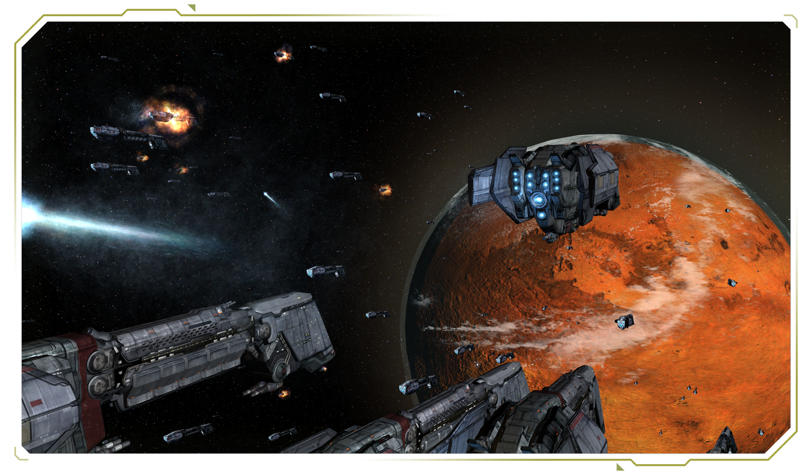
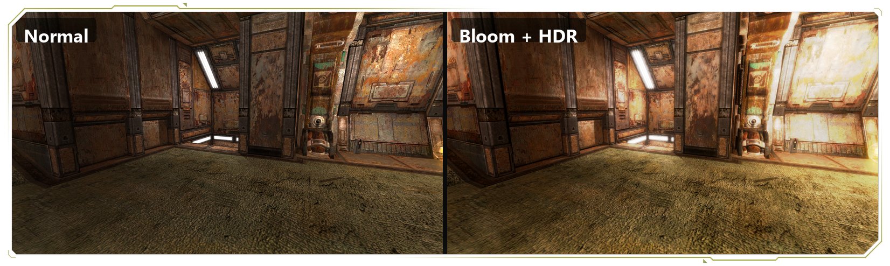
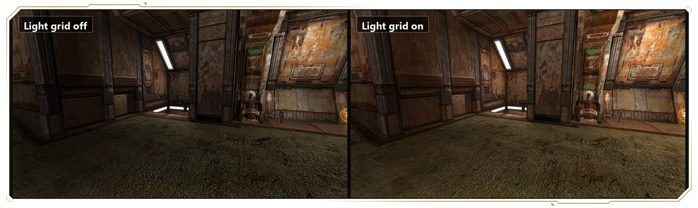
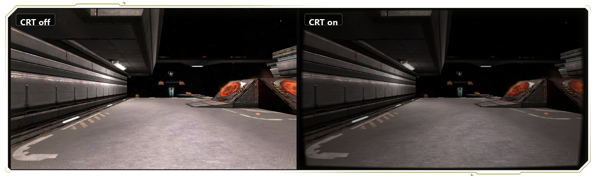

**The modern way to play QUAKE 4.** 
An open-source engine and game-code replacement that runs the original retail game on today's PCs, handhelds and Macs.

[Quick start](#quick-start) · [Features](#features) · [Screenshots](#screenshots) · [Platforms](#platforms-and-requirements) · [Guides](#player-guides) · [Help](#getting-help) · [Build from source](BUILDING.md)

  

## What is openQ4?

openQ4 replaces Quake 4's engine and game binaries with its own: a GPL engine and source-available game modules built from the Quake 4 SDK. Your original campaign and multiplayer maps play as they always did, now with widescreen and high-refresh displays, modern controls, optional visual upgrades and one install for single-player and multiplayer.

> [!NOTE]
> openQ4 does **not** include any Quake 4 game data. You need your own copy from [Steam](https://store.steampowered.com/app/2210/Quake_4/) or [GOG](https://www.gog.com/en/game/quake_4).

## Quick start

1. Install **Quake 4** from Steam or GOG.
2. Download [openQ4 0.13.2](https://github.com/themuffinator/openQ4/releases/tag/v0.13.2) for your system and extract it into its own folder.
3. Launch it:
   - **Windows:** `openQ4-client_x64.exe`
   - **Linux:** make the `x86_64` or `aarch64` AppImage executable and run it
   - **Steam Deck:** `openQ4-steamdeck` from the Linux archive
4. openQ4 finds your Quake 4 install on its own. If it doesn't, see [If auto-detection fails](https://github.com/themuffinator/openQ4/blob/v0.13.2/docs/user/getting-started.md#if-auto-detection-fails).

> [!TIP]
> Not sure which settings to pick? Open **Settings → System** and press **Auto-Detect** next to the performance preset.

Upgrading? Replace the whole package rather than individual files. If you tried the withdrawn 0.14.0, read [returning to 0.13.2](docs/user/release-status.md#installing-or-returning-to-0132) first: it covers your saves.

## Features

What you get in **0.13.2**, the latest release:

- 🖥️ **Built for modern displays.** Widescreen, ultrawide, multi-monitor, borderless and fullscreen all work. On 144 Hz and 240 Hz screens the camera, weapons and moving objects stay smooth between the game's 60 Hz ticks, while gameplay, netcode, demos and saves keep their original timing.
- ✨ **Optional visual upgrades**, each switchable: bloom, HDR, anti-aliasing, soft particles, [baked light grids](https://github.com/themuffinator/openQ4/blob/v0.13.2/docs/user/light-grids.md), [shadow maps](https://github.com/themuffinator/openQ4/blob/v0.13.2/docs/user/shadow-mapping.md), [cel shading](https://github.com/themuffinator/openQ4/blob/v0.13.2/docs/user/cel-shading.md) and a CRT filter.
- 🌊 **Real liquids.** Swim, wade and drown in water, and take damage in slime and lava, in maps built for them. See [Liquids](https://github.com/themuffinator/openQ4/blob/v0.13.2/docs/user/liquids.md).
- 🎮 **Controllers and quality of life**: controller support, a better console and modern settings behaviour.
- 🏆 **More to play.** Alongside the campaign there's the experimental [Arena Campaign](https://github.com/themuffinator/openQ4/blob/v0.13.2/docs/user/arena-campaign.md): bot matches across five tiers of the stock maps, with boss matches and saved progress.
- 🌐 **Better multiplayer** (experimental): a server browser with filters and favourites, [readable chat with history](https://github.com/themuffinator/openQ4/blob/v0.13.2/docs/user/multiplayer-chat.md), Duel queues and spectator match controls.
- 📼 **A demo library and player** with pause, speed control, stepping, rewind and free-fly playback of full-match recordings.
- 🔊 **OpenAL audio**, bundled on macOS so there's nothing extra to install.
- 🧪 **Renderer previews**, off by default: an experimental Vulkan renderer (`r_renderApi vulkan`), [temporal AA and dynamic resolution](https://github.com/themuffinator/openQ4/blob/v0.13.2/docs/user/temporal-presentation.md), and [volumetrics, reflections and indirect light](https://github.com/themuffinator/openQ4/blob/v0.13.2/docs/user/advanced-screen-space-lighting.md). OpenGL remains the recommended renderer in 0.13.2.

Read the full [0.13.2 release notes](docs/dev/releases/v0.13.2.md). Development continues on the next release; see [what's in progress](docs/dev/releases/unreleased.md).

## Screenshots

   
  <b>Bloom and HDR</b> on q4dm2: standard rendering left, enhanced post-processing right.

   
  <b>Baked light grids</b> on q4dm2, off and on.

   
  <b>The CRT filter</b> on q4dm8, off and on.

## Platforms and requirements

Packages are built for Windows x64, Linux x64 and Steam Deck, with preview Linux ARM64, preview Apple Silicon/arm64 macOS and experimental Windows ARM64 builds.

| Platform | Package | Notes |
|---|---|---|
| **Windows x64** | Installer or ZIP | Windows 10/11 recommended |
| **Linux x64** | AppImage (`x86_64`) or archive | A modern 64-bit desktop, comparable to Ubuntu 24.04 or newer |
| **Steam Deck** | Linux archive | Launch `openQ4-steamdeck`; see the [Steam Deck guide](https://github.com/themuffinator/openQ4/blob/v0.13.2/docs/user/steam-deck.md) |
| **Linux ARM64** | AppImage (`aarch64`) or archive | Preview; needs a desktop OpenGL compatibility driver |
| **macOS** | Apple Silicon archive | Preview. These are unsigned OpenGL/Metal bridge packages; players have run them only on current macOS |
| **macOS (signed)** | [Mac Source Ports](https://www.macsourceports.com/game/quake4) | Signed and notarized Apple Silicon and Intel builds by Schnapple |
| **Windows ARM64** | Installer or ZIP | Experimental; not yet confirmed on real hardware |

| | Minimum | Recommended |
|---|---|---|
| **CPU** | 64-bit, dual-core | Modern quad-core |
| **Memory** | 4 GB | 8 GB (16 GB for high presets and resolutions) |
| **Graphics** | OpenGL driver with ARB2-era vertex/fragment program support, ~1 GB VRAM | OpenGL 4.1+ GPU with 2 GB+ VRAM (6 GB+ for `quality` and `ultra`) |
| **Storage** | ~12 GB including Quake 4 | 15 GB+ |

Details for each platform are in [Getting Started](https://github.com/themuffinator/openQ4/blob/v0.13.2/docs/user/getting-started.md#system-requirements).

## Player guides

These guides match the 0.13.2 release. Start with [release status](docs/user/release-status.md) for corrections made since it shipped.

**Set up**
- [Getting Started](https://github.com/themuffinator/openQ4/blob/v0.13.2/docs/user/getting-started.md): install, first launch and common questions
- [Client Settings](https://github.com/themuffinator/openQ4/blob/v0.13.2/docs/user/client-settings.md): where the most useful options live
- [Display Settings](https://github.com/themuffinator/openQ4/blob/v0.13.2/docs/user/display-settings.md) · [Input Settings](https://github.com/themuffinator/openQ4/blob/v0.13.2/docs/user/input-settings.md) · [Gameplay Settings](https://github.com/themuffinator/openQ4/blob/v0.13.2/docs/user/gameplay-settings.md) · [Steam Deck](https://github.com/themuffinator/openQ4/blob/v0.13.2/docs/user/steam-deck.md)

**Play**
- [Arena Campaign](https://github.com/themuffinator/openQ4/blob/v0.13.2/docs/user/arena-campaign.md) (experimental): tiers, unlocks, maps and bots
- [Multiplayer Networking](https://github.com/themuffinator/openQ4/blob/v0.13.2/docs/user/multiplayer-networking.md) (experimental) · [Multiplayer Chat](https://github.com/themuffinator/openQ4/blob/v0.13.2/docs/user/multiplayer-chat.md) · [Competitive Matches](https://github.com/themuffinator/openQ4/blob/v0.13.2/docs/user/competitive-matches.md) (experimental)
- [Demo Library and Multi-View Demos](https://github.com/themuffinator/openQ4/blob/v0.13.2/docs/user/multiview-demos.md): browse, play back and record full matches

**Look and feel**
- [Shadow Mapping](https://github.com/themuffinator/openQ4/blob/v0.13.2/docs/user/shadow-mapping.md) · [Light Grids](https://github.com/themuffinator/openQ4/blob/v0.13.2/docs/user/light-grids.md) · [Classic Dynamic Lights](https://github.com/themuffinator/openQ4/blob/v0.13.2/docs/user/classic-dynamic-lights.md) · [Cel Shading](https://github.com/themuffinator/openQ4/blob/v0.13.2/docs/user/cel-shading.md)
- [Temporal AA and Dynamic Resolution](https://github.com/themuffinator/openQ4/blob/v0.13.2/docs/user/temporal-presentation.md) · [Advanced Screen-Space Lighting](https://github.com/themuffinator/openQ4/blob/v0.13.2/docs/user/advanced-screen-space-lighting.md) (both experimental)
- [DDS Texture Replacements](https://github.com/themuffinator/openQ4/blob/v0.13.2/docs/user/texture-replacements.md) · [Level-Load Cache](https://github.com/themuffinator/openQ4/blob/v0.13.2/docs/user/level-load-cache.md) (experimental)

**Host and create**
- [Server Setup](https://github.com/themuffinator/openQ4/blob/v0.13.2/docs/user/server-setup.md) · [Server Security](https://github.com/themuffinator/openQ4/blob/v0.13.2/docs/user/server-security.md) (read the [protocol correction](docs/user/release-status.md#guides-for-the-available-release))
- [Liquids](https://github.com/themuffinator/openQ4/blob/v0.13.2/docs/user/liquids.md) · [Map Entity Strings](https://github.com/themuffinator/openQ4/blob/v0.13.2/docs/user/map-entity-strings.md): for mappers and modders

## Compatibility

- openQ4 runs the **official retail Quake 4 assets** with its **own engine and game modules**.
- Mods built for the original proprietary Quake 4 game DLLs won't load.
- Retail Quake 4 clients and servers can't join openQ4 games, or the other way round. Play with matching openQ4 builds.
- openQ4 is in **beta**: compatibility work is ongoing.

## Getting help

- **Something broken?** Open an [issue](https://github.com/themuffinator/openQ4/issues) with your log file and setup details.
- **On a Mac?** Collect support data with the [macOS support-data guide](https://github.com/themuffinator/openQ4/blob/v0.13.2/docs/user/macos-support-data.md) first.
- **On ARM64?** The Windows and Linux ARM64 issue templates want your results, and "it just worked" counts as a useful report.
- **Want to chat?** Find us in **#openq4** on the [DarkMatter Discord](https://discord.gg/T32mFejwR4).

## For developers

- [BUILDING.md](BUILDING.md): build openQ4 on Windows, Linux and macOS
- [TECHNICAL.md](TECHNICAL.md): configuration, file layout and engine internals
- [Android, GLES and SigmaTouch](docs/dev/android-build.md): the experimental Android build
- [The engine capability matrix](docs/dev/engine-capability-matrix.md): what is implemented, experimental or missing
- [CONTRIBUTING.md](.github/CONTRIBUTING.md): project conventions for pull requests

## Credits

**themuffinator** leads openQ4's development, with stewardship from **DarkMatter Productions**. Thanks to **[Schnapple / Mac Source Ports](https://www.macsourceports.com/game/quake4)** for the signed macOS builds, **[Emile Belanger (emileb)](https://github.com/emileb)** for the Android port and OpenGL ES renderer, and **akacross** for tireless playtesting on Linux and Windows.

<b>Full credits and third-party software</b>

- **themuffinator**: openQ4 development and maintenance
- **[Schnapple / Mac Source Ports](https://www.macsourceports.com/game/quake4)**: signed and notarized macOS builds for Apple Silicon and Intel Macs
- **[Emile Belanger (emileb)](https://github.com/emileb)**: contributor and original author of the Android port, SigmaTouch integration, OpenGL ES 3.0 renderer, GLES shader variants, ETC2/EAC compression, and associated mobile memory/loading work. This integration builds on his [Android branch](https://github.com/emileb/openQ4/tree/android) and [GLES shader-variants branch](https://github.com/emileb/openQ4/tree/gles-shader-variants); see the [contribution and adaptation record](docs/dev/android-gles-integration.md).
- **DarkMatter Productions**: project stewardship and [website](https://www.darkmatter-quake.com)
- **[The RmlUi Team, CodePoint, Shift Technology and contributors](https://github.com/mikke89/RmlUi/tree/6.3)**: MIT-licensed layout library behind the new interface, with [openQ4 patches](subprojects/packagefiles/rmlui/README.openq4.md); [licence notice](LICENSES/RmlUi.txt)
- **[Baptiste Lepilleur and the JsonCpp authors](https://github.com/open-source-parsers/jsoncpp/tree/1.9.8)**: JSON parser for the new interface's source files, used under its MIT option with an [openQ4 patch](subprojects/packagefiles/jsoncpp/subnormal-numbers.patch); [licence notice](LICENSES/JsonCpp.txt)
- **[Mikko Mononen, Eric Veach and the libtess2 contributors](https://github.com/memononen/libtess2/tree/8dbd6483e920311a58c9af10a10beb278efebc36)**: SGI-B-2.0 polygon tessellator for the new interface's vector shapes, with an [openQ4 precision patch](subprojects/packagefiles/libtess2/double-precision.patch); [licence notice](LICENSES/libtess2.txt)
- **[Q2REX Project Team](https://github.com/themuffinator/Q2REX)**: design reference for the [multiplayer chat panel](docs/user/multiplayer-chat.md)
- **[MuffMode](https://github.com/themuffinator/MuffMode)** and **[Q4MAX](https://www.moddb.com/mods/q4max)**: multiplayer workflow and usability references
- **[Team Beef](https://github.com/Team-Beef-Studios)**: design reference for [VR mode](docs/user/vr.md): [PreyVR](https://github.com/Team-Beef-Studios/PreyVR) (Luboš Vonásek, GLKarin, DrBeef, Baggyg, Bummser and contributors) and [Doom3Quest](https://github.com/DrBeef/Doom3Quest) (DrBeef and contributors) shaped its head-driven movement, two-handed aim, zoom, comfort options and physical crouch; ideas only, no code copied
- **Justin Marshall**: Quake4Doom and early BSE reverse-engineering reference work, and recovering and publishing Quake 4: The Awakening
- **Daniel Gibson and the [dhewm3](https://github.com/dhewm/dhewm3) contributors**: cinematic JPEG handling inherited through Quake4Doom, and the `dds/` texture-replacement naming convention openQ4 follows
- **Robert Beckebans**: renderer modernization reference work, including RBDOOM-3-BFG inspiration
- **id Software's official Doom 3 and Doom 3 BFG source releases**: retained idTech 4 source lineage; see the [source-provenance inventory](docs/dev/source-provenance.md)
- **id Software** and **Raven Software**: Quake 4 and the underlying technology
- **Raven Software** and **Ritual Entertainment**: Quake 4: The Awakening, the unreleased expansion
- **Chris Robinson and the [OpenAL Soft](https://openal-soft.org/) contributors**: cross-platform OpenAL runtime bundled in macOS packages
- **Sam Lantinga and the [SDL contributors](https://github.com/libsdl-org/SDL/tree/release-3.4.18)**: cross-platform window, input and microphone support, including the dummy audio driver used in automated voice tests; SDL uses the zlib licence
- **Sean Barrett and the [stb_vorbis contributors](https://github.com/nothings/stb/blob/master/stb_vorbis.c)**: MIT/public-domain Vorbis decoding; openQ4 adds a virtual-filesystem callback path for bounded compressed streaming
- **The Khronos Group and [glslang contributors](https://github.com/KhronosGroup/glslang/tree/16.6.0)**: GLSL-to-SPIR-V compiler used by the Vulkan renderer; its complete licence ships under `licenses/`
- **[The Khronos Group, Valve Corporation and LunarG](https://github.com/KhronosGroup/OpenXR-SDK/tree/release-1.1.65)**: Apache-2.0 OpenXR loader and headers behind [VR mode](docs/user/vr.md); [licence notice](LICENSES/openxr-sdk.txt)
- **[The Khronos Group](https://github.com/KhronosGroup/OpenGL-Registry)**: MIT-licensed OpenGL ES API headers, with their original notices retained
- **akacross** (Discord): thorough playtesting on Linux and Windows, a huge help moving the project forward

## Licence

The openQ4 engine is licensed under the [GNU General Public License v3.0](LICENSE). Files that keep Doom 3 or Doom 3 BFG Edition headers also keep their upstream notices and Additional Terms; the [source-provenance inventory](docs/dev/source-provenance.md) records their scope and lineage.

The game code in [`src/game`](src/game/) and [`src/mpgame`](src/mpgame/) is derived from the Quake 4 SDK and remains under [id Software's SDK EULA](LICENSES/QUAKE-4-SDK-EULA.rtf). [LICENSING.md](LICENSING.md) explains each component's terms, including the open question about distributing them linked together. Quake 4's assets remain the property of id Software and ZeniMax Media.

openQ4 is an independent project and is not affiliated with, endorsed by or sponsored by id Software, Raven Software, Bethesda or ZeniMax Media.

---

  <a href="https://www.darkmatter-quake.com">Website</a> · <a href="https://github.com/themuffinator/openQ4/releases">Releases</a> · <a href="https://github.com/themuffinator/openQ4/issues">Issues</a> · <a href="https://discord.gg/T32mFejwR4">Discord</a> · <a href="#top">Back to top</a>

